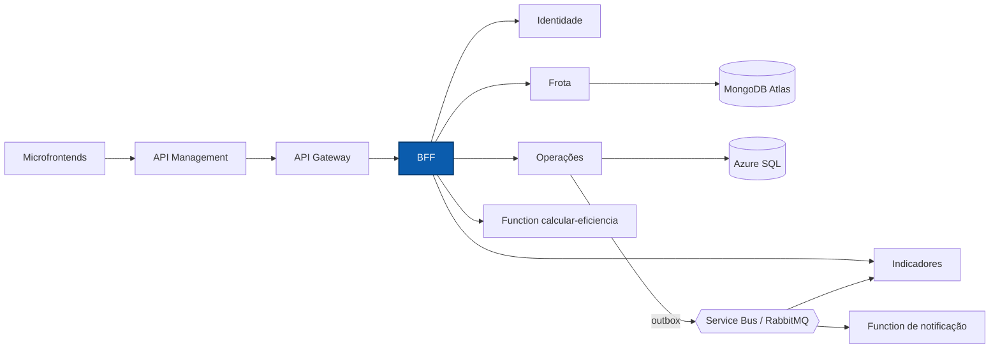

# NexFleet BFF

Backend for Frontend do NexFleet: valida o usuário, orquestra os microsserviços e devolve à aplicação web respostas prontas para a tela, inclusive a visão consolidada da frota.

[](https://github.com/mateusblm/nexfleet-bff/actions/workflows/ci.yml)
[](https://hub.docker.com/r/mateusblm/nexfleet-bff)


---

## Visão geral

O NexFleet é uma plataforma de gestão de frotas empresariais: veículos, motoristas, vínculos, abastecimentos, manutenções, painel de custos e uma visão consolidada de eficiência.

O **BFF** recebe as chamadas que chegam pelo API Management e pelo API Gateway, valida o JWT emitido pela Identidade (chave pública via JWKS) e repassa ou compõe as respostas de Identidade, Frota, Operações, Indicadores e da Function `calcular-eficiencia`. Não tem banco de dados próprio.



## Funcionalidades

- Login e consulta do usuário atual, delegados à Identidade.
- Validação do JWT pela JWKS da Identidade (`/.well-known/jwks.json`, perfil `jwt-rsa`).
- Cadastros de usuários, veículos, motoristas e vínculos; registros de abastecimentos e manutenções, encaminhados ao serviço dono de cada dado.
- Exclusão definitiva de veículo bloqueada quando há manutenções registradas em Operações (Frota aplica as demais regras: registro inativo e sem histórico).
- Painel composto por Indicadores (gastos e próximas manutenções) e Frota (situação dos veículos).
- **Visão consolidada** (`GET /aggregated-data`): Frota, Operações e eficiência em um único JSON, com retorno parcial quando uma fonte falha.
- Situação do ambiente e dos serviços (`GET /api/v1/ambiente`, pública).
- Propagação do `X-Correlation-ID` para todos os serviços chamados.

## Arquitetura

**Clean Architecture + Vertical Slice.** Cada caso de uso é uma fatia em `br.com.nexfleet.bff`, com as camadas `api` (controllers REST), `application` (caso de uso e portas) e `infrastructure` (clientes HTTP dos serviços). O BFF não tem regras de domínio próprias, portanto não há camada `domain`.

| Fatia | Responsabilidade |
|---|---|
| `autenticar` | Login e usuário atual, repassados à Identidade |
| `gerenciarusuarios` | Administração de usuários |
| `gerenciarveiculos` | Cadastro de veículos; checagem de manutenções antes da exclusão definitiva |
| `gerenciarmotoristas` | Cadastro de motoristas |
| `gerenciarvinculos` | Vínculos motorista ↔ veículo |
| `gerenciarabastecimentos` | Registro e listagem de abastecimentos |
| `gerenciarmanutencoes` | Registro e listagem de manutenções |
| `consultardashboard` | Painel composto por Indicadores e Frota |
| `consultaragregado` | `GET /aggregated-data` |
| `consultarambiente` | Situação do ambiente e dos serviços |

Pacotes técnicos: `config` (composição, clientes HTTP, segurança e JWKS) e `observability` (correlação).

Regras verificadas pelo ArchUnit (`ArchitectureTest`):

- `application` não depende de Spring, JPA, `infrastructure` nem `api`;
- `api` não acessa `infrastructure` nem persistência diretamente;
- nenhuma classe importa código interno de outros serviços.

## API

| Método | Rota | Descrição |
|---|---|---|
| `POST` | `/api/v1/auth/login` | Login; devolve o JWT |
| `GET` | `/api/v1/auth/me` | Usuário autenticado |
| `GET` | `/api/v1/ambiente` | Situação do ambiente (pública) |
| `GET`, `POST` | `/api/v1/usuarios` | Listar e criar usuários |
| `GET`, `PUT`, `DELETE` | `/api/v1/usuarios/{id}` | Consultar, editar e inativar usuário |
| `DELETE` | `/api/v1/usuarios/{id}/definitivo` | Excluir usuário |
| `GET`, `POST` | `/api/v1/veiculos` | Listar e cadastrar veículos |
| `GET`, `PUT`, `DELETE` | `/api/v1/veiculos/{id}` | Consultar, editar e inativar veículo |
| `DELETE` | `/api/v1/veiculos/{id}/definitivo` | Excluir veículo inativo e sem histórico |
| `GET`, `POST` | `/api/v1/motoristas` | Listar e cadastrar motoristas |
| `GET`, `PUT` | `/api/v1/motoristas/{id}` | Consultar e editar motorista |
| `DELETE` | `/api/v1/motoristas/{id}/definitivo` | Excluir motorista inativo e sem histórico |
| `GET`, `POST` | `/api/v1/vinculos` | Listar e criar vínculos |
| `PUT` | `/api/v1/vinculos/{id}/encerramento` | Encerrar vínculo |
| `GET`, `POST` | `/api/v1/abastecimentos` | Listar e registrar abastecimentos |
| `GET`, `POST` | `/api/v1/manutencoes` | Listar e registrar manutenções |
| `GET` | `/api/v1/dashboard` | Painel de custos e situação da frota |
| `GET` | `/aggregated-data`, `/api/v1/aggregated-data` | Visão consolidada |

O OpenAPI do BFF é publicado em `/v3/api-docs` e reunido na Swagger UI do Gateway: **[Swagger UI em produção](https://apim-nexfleet-homolog-ukzjodf42myfe.azure-api.net/swagger-ui.html)**. O contrato completo da visão consolidada está em [`contracts/aggregated-data.openapi.yaml`](https://github.com/mateusblm/nexfleet/blob/main/contracts/aggregated-data.openapi.yaml), no repositório `nexfleet`.

### `GET /aggregated-data`

Exige `Authorization: Bearer <token>`. O BFF:

1. consulta **Frota** (veículos, motoristas e vínculos ativos) e **Operações** (abastecimentos e manutenções) em paralelo, cada uma com tempo limite próprio (`AGREGADO_TIMEOUT`, padrão 5 s);
2. envia o histórico de Operações, agrupado por veículo, à **Function** `POST /api/calcular-eficiencia`, com a chave no cabeçalho `x-functions-key`;
3. responde `200` com `Cache-Control: no-store`.

Exemplo resumido:

```json
{
  "frota": {
    "veiculos": [
      { "id": "…", "placa": "ABC1D23", "marca": "…", "modelo": "…", "ano": 2024,
        "tipo": "…", "quilometragem": 10500, "status": "EM_USO" }
    ],
    "motoristas": [
      { "id": "…", "nome": "…", "categoria": "B", "validadeCnh": "2028-05-10", "status": "…" }
    ],
    "vinculosAtivos": [
      { "id": "…", "veiculoId": "…", "veiculoPlaca": "ABC1D23",
        "motoristaId": "…", "motoristaNome": "…", "inicio": "2026-10-01T08:00:00Z" }
    ]
  },
  "operacoes": {
    "abastecimentos": [
      { "id": "…", "veiculoId": "…", "realizadoEm": "2026-10-20T10:00:00Z",
        "combustivel": "…", "litros": 50, "valorTotal": 250.50, "quilometragem": 10500 }
    ],
    "manutencoes": [
      { "id": "…", "veiculoId": "…", "tipo": "…", "realizadaEm": "2026-10-15",
        "quilometragem": 10300, "valor": 99.25, "proximaManutencao": null }
    ],
    "truncado": false
  },
  "eficiencia": {
    "veiculos": [
      { "veiculoId": "…", "placa": "ABC1D23", "consumoMedioKmL": 6.25, "custoPorKm": 1.50,
        "gastoAbastecimento": 600.75, "gastoManutencao": 149.25, "gastoTotal": 750.00,
        "distanciaKm": 500 }
    ],
    "frota": { "consumoMedioKmL": 6.25, "custoPorKm": 1.50, "gastoTotal": 750.00, "distanciaKm": 500 }
  },
  "fontes": { "frota": "ok", "operacoes": "ok", "funcao": "ok" },
  "geradoEm": "2026-11-11T12:00:00Z"
}
```

**Retorno parcial.** `fontes` informa `"ok"` ou `"falhou"` para `frota`, `operacoes` e `funcao`. A seção de uma fonte que falhou ou estourou o tempo limite vem vazia e o restante continua preenchido:

- se **Operações** falhar, a Function não é chamada e `fontes.funcao` também vem `"falhou"`;
- se as **três** fontes falharem, a resposta é `502`; sem token, `401`.

**Limites.** `operacoes` traz até os 10 registros mais recentes de cada tipo. Para o cálculo, o BFF lê até 1.000 itens por listagem de Frota e até 4.000 abastecimentos e 4.000 manutenções de Operações; acima disso corta, registra aviso com o `correlationId` e marca `operacoes.truncado = true`.

## Stack

| Camada | Tecnologia | Versão |
|---|---|---|
| Linguagem | Java | 21 |
| Framework | Spring Boot (Web MVC, Security, OAuth2 Resource Server, Actuator) | 4.1.1 |
| Documentação | springdoc-openapi (`/v3/api-docs`) | 3.2.0 |
| Observabilidade | Micrometer + Prometheus | gerenciada pelo Spring Boot |
| Testes | JUnit 5, MockMvc, ArchUnit | 5 / — / 1.4.1 |
| Build | Maven Wrapper | 3.9.16 |
| Contêiner | `eclipse-temurin:21-jre-jammy` | 21 |
| CI/CD | GitHub Actions → Docker Hub | — |

## Primeiros passos

### Pré-requisitos

- JDK 21 (o Maven vem pelo wrapper `./mvnw`)
- Docker, para gerar e executar a imagem

### Testes

```bash
./mvnw -B -ntp verify
```

### Executar com Docker

```bash
docker run --rm -p 8090:8080 \
  -e SPRING_PROFILES_ACTIVE=jwt-rsa \
  -e IDENTIDADE_URL=http://<host-da-identidade>:8080 \
  -e FROTA_URL=http://<host-da-frota>:8080 \
  -e OPERACOES_URL=http://<host-de-operacoes>:8080 \
  -e INDICADORES_URL=http://<host-de-indicadores>:8080 \
  -e EFICIENCIA_FUNCTION_URL=http://<host-da-function> \
  -e EFICIENCIA_FUNCTION_KEY=<chave-da-função> \
  mateusblm/nexfleet-bff:v1.0.0
```

Para gerar a imagem a partir do código: `docker build -t mateusblm/nexfleet-bff:local .`

### Ambiente completo

O produto inteiro (todos os serviços, SQL Server, MongoDB e RabbitMQ) sobe pelo repositório [nexfleet](https://github.com/mateusblm/nexfleet):

```bash
git clone https://github.com/mateusblm/nexfleet.git && cd nexfleet
scripts/clonar-tudo.sh                                        # clona os demais repositórios ao lado
scripts/iniciar-local.sh                                      # gera o .env e a chave RSA local
docker compose -f compose.yaml -f compose.build.yaml up -d --build
scripts/seed-demo.sh                                          # dados de demonstração
```

A visão consolidada fica em `http://127.0.0.1:8080/aggregated-data` (pelo Gateway, com token).

## Configuração

| Variável | Descrição | Padrão |
|---|---|---|
| `PORT` | Porta HTTP | `8080` |
| `SPRING_PROFILES_ACTIVE` | `jwt-rsa` valida o token pela JWKS da Identidade | — |
| `IDENTIDADE_URL` | URL da Identidade | `http://localhost:8081` |
| `FROTA_URL` | URL de Frota | `http://localhost:8082` |
| `OPERACOES_URL` | URL de Operações | `http://localhost:8083` |
| `INDICADORES_URL` | URL de Indicadores | `http://localhost:8084` |
| `EFICIENCIA_FUNCTION_URL` | URL base da Function de eficiência | `http://localhost:7071` |
| `EFICIENCIA_FUNCTION_KEY` | Chave da função (`x-functions-key`); segredo | vazio |
| `AGREGADO_TIMEOUT` | Tempo limite por fonte em `/aggregated-data` | `5s` |

## Ambiente em nuvem

| Recurso | Endereço |
|---|---|
| Aplicação | https://white-mushroom-0cadda010.3.azurestaticapps.net |
| API (Azure API Management) | https://apim-nexfleet-homolog-ukzjodf42myfe.azure-api.net |
| Visão consolidada (com token) | https://apim-nexfleet-homolog-ukzjodf42myfe.azure-api.net/aggregated-data |
| Swagger UI | https://apim-nexfleet-homolog-ukzjodf42myfe.azure-api.net/swagger-ui.html |
| AsyncAPI dos eventos | https://white-mushroom-0cadda010.3.azurestaticapps.net/docs/eventos/ |
| Imagem Docker | https://hub.docker.com/r/mateusblm/nexfleet-bff |

O BFF roda em Azure Container Apps e é alcançado só pelo API Management e pelo Gateway.

> Os serviços escalam a zero quando ociosos. A primeira requisição após um período de inatividade pode levar de 1 a 2 minutos.

## Testes

| Tipo | Exemplos | O que cobre |
|---|---|---|
| Unitários e de API (MockMvc) | `ConsultarAgregadoHttpTest`, `ConsultarDashboardWebTest`, `AutenticarWebTest` | Controllers, casos de uso, retorno parcial e códigos de erro |
| Clientes HTTP | `HttpEficienciaTest`, `OperacoesPorServicosTest`, `FrotaPorServicosTest`, `HttpVeiculosTest` | Chamadas aos serviços e montagem das fontes da visão consolidada |
| Segurança | `RsaAuthHttpTest`, `JwksConfigTest` | Validação do JWT via JWKS |
| Arquitetura (ArchUnit) | `ArchitectureTest` | Dependências entre camadas e isolamento entre serviços |

```bash
./mvnw -B -ntp verify
```

O CI (`.github/workflows/ci.yml`) executa `verify` a cada push e pull request; em tags `v*`, publica `mateusblm/nexfleet-bff:<tag>` e `:latest` no Docker Hub.

## Equipe

- Vinícius dos Reis Góes
- Mateus Burlamaqui
- Lucas Roussenq
- Erik Carvalho
